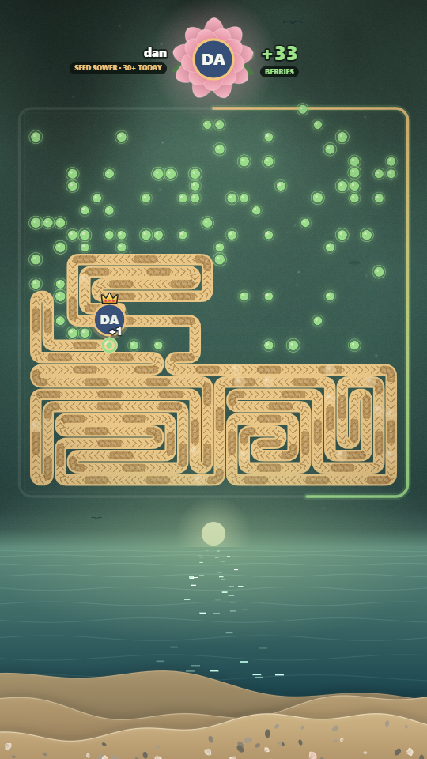
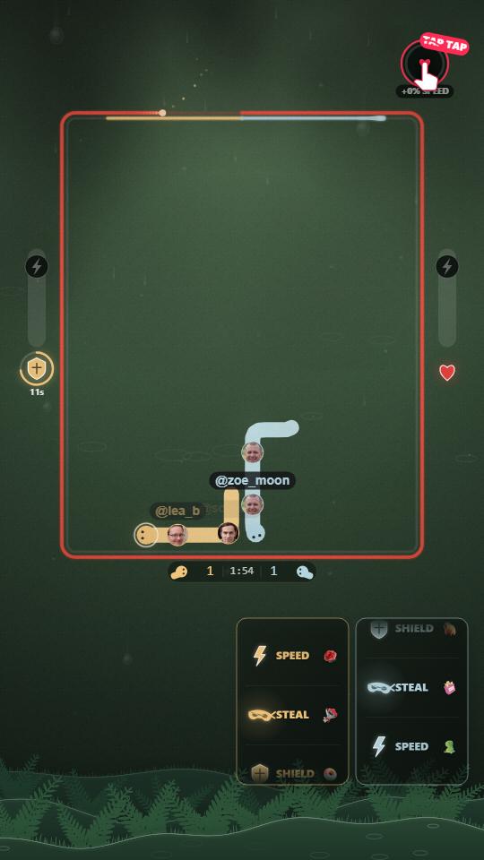
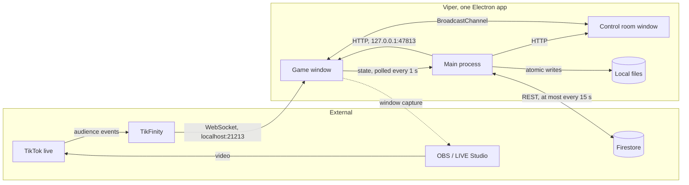

# Viper

[](https://github.com/abdelhafidmaamir/viper/actions/workflows/ci.yml)

Viper is a desktop app (Electron, TypeScript) that renders a snake game for a live
stream. The game takes no local input. Its inputs are audience events from a TikTok live
(likes, follows, paid gifts), received over a local WebSocket. Its output is a window that
broadcasting software captures as the video source.

<p align="center">
  
  &nbsp;&nbsp;
  
</p>

Status: 0.9.1, in use on real streams. Solo project.

## What was built

| Area             | What it does                                                                                                                                       | Where                                                        |
| ---------------- | -------------------------------------------------------------------------------------------------------------------------------------------------- | ------------------------------------------------------------ |
| Event adapter    | Turns a third-party WebSocket feed into typed game events: reconnect with backoff, deduplication, incremental counting of cumulative gift counters | `src/renderer/scripts/tikfinity-bridge.ts`                   |
| Two simulations  | A two-snake duel and a board-filling snake on a Hamiltonian loop, each with its own rules, state and typed message protocol                        | `src/renderer/engine/`, `src/renderer/feed/`, `src/shared/`  |
| Snake AI         | A path planner with escape checks, and a minimax search with alpha-beta pruning, iterative deepening and a time budget                             | `src/renderer/scripts/ai-human.ts`, `ai-super.ts`            |
| Rendering        | Canvas 2D in a fixed 1080x1920 frame, cached offscreen layers, twelve procedural sceneries with a day and night cycle                              | `src/renderer/engine/frame.ts`, `scripts/forest-ambience.ts` |
| Persistence      | Crash-safe round backup, append-only CSV journal, long-term supporters list, all written by the main process with atomic file swaps                | `src/main/feed-backup.ts`, `feed-journal.ts`                 |
| Cloud sync       | Supporters list mirrored to Firestore over REST, sharded past the document size limit, optional                                                    | `src/main/feed-cloud.ts`                                     |
| Operator console | A second window with settings, test inputs, live state and a simulated audience                                                                    | `src/renderer/control/`, `feed-control/`                     |
| Test harness     | Headless runs of the real game on a recording canvas, golden hash of draw calls, screenshot diff                                                   | `tests/`                                                     |
| Self-measurement | Frame timing, CPU profile, draw-call count and screenshots taken by the packaged exe itself                                                        | `src/main/diagnostics/`                                      |
| Delivery         | CI on every pull request (checks, packaging, screenshot diff), tag-driven Windows release                                                          | `.github/workflows/`                                         |

## System overview



| Component    | Role                                                                                |
| ------------ | ----------------------------------------------------------------------------------- |
| TikFinity    | Third-party app. Connects to the live and re-emits its events on a local WebSocket. |
| Game window  | Renderer. Runs the simulation and draws it on one canvas. The only captured window. |
| Control room | Renderer. Settings, test inputs, live state. Operator only.                         |
| Main process | Serves the pages, owns the windows, and persists what must survive a crash.         |
| Local files  | Round backup, supporters list, one CSV journal per stream (`%APPDATA%\Viper Duel`). |
| Firestore    | Online copy of the supporters list, so it survives a machine or build change.       |

Viper has no direct connection to TikTok and does not encode or upload video. Firestore is
optional: without its config file the supporters list stays local.

## Design constraints

| Constraint                                               | Consequence in the code                                                                                |
| -------------------------------------------------------- | ------------------------------------------------------------------------------------------------------ |
| Input is an external event stream: bursty, duplicated    | One adapter (`tikfinity-bridge.ts`) normalises and deduplicates; the game only sees its own event type |
| Some events are payments and must not be lost            | Round state written to disk every second and restored on launch; unspent credit carries to next round  |
| The process runs for hours with nobody watching it       | Auto-reconnect, automatic restore, rounds chain without operator action                                |
| The window is captured while hidden behind other windows | Background throttling and occlusion detection disabled; framed window with a fixed title               |
| Behaviour must not change silently during refactoring    | Simulation runs headless in tests; draw calls are hashed against a golden record                       |

## Game modes

The app ships two games. A launcher picks one; each has its own game window, control room and
message protocol.

|               | Duel                                                 | Feed                                              |
| ------------- | ---------------------------------------------------- | ------------------------------------------------- |
| Simulation    | Two AI-driven snakes compete on a 16x20 grid         | One snake follows a fixed loop on a 30x30 grid    |
| Paid events   | Assign the sender to a team and apply an effect      | Add food to the board, one unit per coin          |
| Likes         | Raise the speed of both snakes                       | Rank the sender; no effect on the board           |
| Round ends on | Target length held for 5 s, a knockout, or the clock | Board full                                        |
| Persistence   | Settings only                                        | Round backup, supporters list, journal, Firestore |

Rules and constants: [docs/rules-duel.md](docs/rules-duel.md),
[docs/rules-feed.md](docs/rules-feed.md).

## Running it

Requires Node 24 (see `.nvmrc`).

```bash
npm install
npm run dev               # Vite dev server and Electron, hot reload
npm start                 # production build, then run
```

`--mode=duel|feed` skips the launcher. `npm run start:landscape` starts in 16:9, which only the
Duel supports.

TikFinity is not required for development. The control room has a simulated audience that
generates events locally.

| Script                      | What it does                                     |
| --------------------------- | ------------------------------------------------ |
| `npm run check`             | format, lint, typecheck, tests (same as CI)      |
| `npm test`                  | Vitest                                           |
| `npm run lint` / `lint:fix` | ESLint                                           |
| `npm run format`            | Prettier                                         |
| `npm run visual`            | screenshot diff against `tests/visual/baselines` |
| `npm run package`           | portable build in `out/Viper-win32-x64`          |

## Testing

- Tests run in Node with Vitest. The game scripts are loaded against a fake canvas that records
  draw calls (`tests/support/boot-game.ts`).
- A golden test replays seeded rounds and compares a hash of the recorded draw calls.
- `npm run visual` runs the game with a seeded clock in software rendering and diffs screenshots
  against baselines. Baselines are Windows-specific (system fonts). `npm run visual -- --update`
  regenerates them.
- CI runs the checks, the packaging and the screenshot diff on every pull request.

## Diagnostics

The packaged exe can measure itself on the machine that streams:

```bash
Viper.exe --diagnostic=screenshots  --out=shots
Viper.exe --diagnostic=frame-timing --out=perf --all-weathers
Viper.exe --diagnostic=draw-calls   --out=perf
Viper.exe --diagnostic=cpu-profile  --out=perf
Viper.exe --diagnostic=feed-timing  --out=perf
```

Options: `--orientation=portrait|landscape`, `--weather=<name>`, `--hour=<0..1>`,
`--settle=<seconds>`. In development: `npm run diagnose -- screenshots --out=shots`.

## Releases

Pushing a `vX.Y.Z` tag runs the checks, builds on Windows and publishes a zip with its SHA-256 as
a GitHub release. The tag must match `package.json`.

```bash
npm version minor
git push --follow-tags
```

Minor: a change visible on stream. Patch: a fix. 1.0.0 is reserved for the first version that
holds a full stream without intervention. The exe is not code-signed.

## Known limits

- Supporters sync is last-writer-wins on the whole list. Two machines running at the same time
  would overwrite each other.
- The TikFinity message format is not a published contract. The adapter is the only place that
  depends on it.
- The Duel has no crash recovery.
- Releases are packaged for Windows x64 only, because that is where it streams. Nothing in the
  code is platform-specific and the test suite runs on Linux in CI, but macOS and Linux builds
  are not packaged and have not been run. Screenshot baselines are Windows captures.

## Repository layout

```text
src/main/            main process: static server, windows, persistence, diagnostics
src/renderer/        one page per window, built with Vite
  launcher/          mode selection
  game/              Duel page entry
  engine/            Duel modules (rules, crowd, hazards, drawing)
  scripts/           simulation core, AI, scenery, TikFinity adapter, simulated audience
  control/           Duel control room, and UI parts shared by both control rooms
  feed/              Feed game
  feed-control/      Feed control room
src/shared/          message protocols between game and control room
tests/               Vitest suites, headless game runs, visual baselines
scripts/             dev and packaging scripts
```

## Documentation

| Document                                     | Content                                         |
| -------------------------------------------- | ----------------------------------------------- |
| [docs/architecture.md](docs/architecture.md) | Processes, windows, modules, persistence, tests |
| [docs/decisions.md](docs/decisions.md)       | Technical choices and their cost                |
| [docs/operations.md](docs/operations.md)     | Data files, recovery, sync, release             |
| [docs/rules-duel.md](docs/rules-duel.md)     | Duel rules and constants                        |
| [docs/rules-feed.md](docs/rules-feed.md)     | Feed rules and constants                        |
| [docs/concepts.md](docs/concepts.md)         | Glossary of the live-streaming terms used       |
| [docs/roadmap.md](docs/roadmap.md)           | Done and planned                                |

© Abdel Maamir. All rights reserved.
