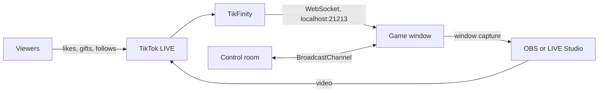

# Viper

[](https://github.com/abdelhafidmaamir/viper/actions/workflows/ci.yml)

Viper is a snake game that nobody plays with a controller. It runs during a live stream, and the
people watching steer it with what they already do on the stream: liking, sharing, following,
sending gifts. The streamer only shows the game window.

<p align="center">
  
  &nbsp;&nbsp;
  
</p>

<p align="center"><sub>Feed the Snake on the left, Duel on the right. Both with the built-in fake audience.</sub></p>

## The idea, if you don't know TikTok LIVE

On TikTok LIVE a creator broadcasts and viewers react in real time. They can tap to like, share,
follow, comment, and send gifts, which are small paid animations. An interactive live game treats
those reactions as its only input. The viewers are the players, there can be thousands of them,
and none of them installed anything.

That changes what the software has to be good at:

- **No player input to trust.** Events arrive from the outside, in bursts, sometimes twice,
  sometimes late. The game has to stay fair and readable whatever comes in.
- **Gifts are real money.** If a viewer paid for something, it has to show up on screen, even
  after a crash or a restart.
- **It runs for hours, unattended.** The streamer is talking to the room, not watching the app.
- **It's watched on a phone.** Portrait 9:16, big shapes, almost no text.

## Two modes

|                 | Duel                                                           | Feed the Snake                                           |
| --------------- | -------------------------------------------------------------- | -------------------------------------------------------- |
| What happens    | Two AI snakes, Gold and Shadow, fight over the board           | One snake follows a fixed route until it fills the board |
| What gifts do   | Pick a side and trigger an effect (speed, steal...)            | Drop berries: a Rose is 1 berry, a Rosa is 10            |
| What likes do   | Fill a shared orb that speeds both snakes up                   | Rank the viewer (and, by the sea, give them a crab)      |
| A round ends on | A side holding a full ring (40 segments) for 5 s, or the clock | A full board, then a leaderboard and the next round      |
| Viewers are     | Two teams against each other                                   | One room working together                                |

A launcher asks which mode to open. Each mode has its own game window (the one that goes on
stream) and its own control room (private, for the streamer).

## How it fits together



- **TikFinity** is a third-party desktop app that connects to a live and re-emits its events on a
  local WebSocket. Viper never talks to TikTok directly.
- **The game window** draws everything on one canvas. It is the only thing viewers see.
- **The control room** is a second window with the settings, test buttons and live state. The two
  talk over a `BroadcastChannel`, so the game has no idea whether a command came from a button or
  from a test.
- **The stream** is a plain window capture. Viper doesn't encode or broadcast anything itself.

Without TikFinity the app still runs: the control room has a fake audience that feeds the same
game rules. In the Duel it enters through the exact function TikFinity calls. In Feed it skips the
journal and the supporters list on purpose, since only real viewers belong there. That's how the
screenshots above were taken, and how the game is rehearsed before a live.

## Running it

Node 24 (see `.nvmrc`). It's an Electron app, built and packaged on Windows.

```bash
npm install
npm run dev               # dev server + hot reload
npm start                 # build and run, 9:16
```

`npm run start:landscape` starts in 16:9, which only the Duel supports (for YouTube, the background
extends into the sides). `--mode=duel` or `--mode=feed` skips the launcher.

| Script                      | What it does                                     |
| --------------------------- | ------------------------------------------------ |
| `npm test`                  | Vitest                                           |
| `npm run check`             | format, lint, typecheck, tests (same as CI)      |
| `npm run lint` / `lint:fix` | ESLint                                           |
| `npm run format`            | Prettier                                         |
| `npm run package`           | portable build in `out/Viper-win32-x64`          |
| `npm run visual`            | screenshot diff against `tests/visual/baselines` |

`npm run visual -- --update` replaces the baselines when a visual change is intended.

## What's worth a look in the code

- **Tests without a screen.** The real game scripts run in Node against a fake canvas that records
  every draw call. A golden test replays seeded rounds and compares a hash of those calls, so a
  refactor can't change a frame silently. `npm run visual` does the same on real pixels.
- **Nothing paid gets lost.** In Feed, the main process saves the round every second and restores
  it on the next launch; berries that didn't fit carry over to the next round with their donor's
  rank.
- **The app measures itself.** The packaged exe takes its own screenshots, frame timings and CPU
  profiles (see below), which is how performance gets checked on the machine that streams.
- **One writer per state.** Each engine module owns its state; the others read it or call its
  functions.

The reasoning behind the odd-looking choices (local HTTP server, fixed port, framed window, no
background throttling) is in [docs/architecture.md](docs/architecture.md).

## Diagnostics

```bash
Viper.exe --diagnostic=screenshots  --out=shots
Viper.exe --diagnostic=frame-timing --out=perf --all-weathers
Viper.exe --diagnostic=draw-calls   --out=perf
Viper.exe --diagnostic=cpu-profile  --out=perf
Viper.exe --diagnostic=feed-timing  --out=perf
```

Options: `--orientation=portrait|landscape`, `--weather=<name>`, `--hour=<0..1>`,
`--settle=<seconds>`. In dev: `npm run diagnose -- screenshots --out=shots`.

## Releases

Pushing a version tag builds the Windows zip and creates the GitHub release. The tag has to match
`package.json`.

```bash
npm version minor
git push --follow-tags
```

A minor is a feature viewers can see, a patch is a fix. 1.0.0 is reserved for the first version
I consider stable over a full real live. The exe isn't signed yet, so SmartScreen will complain
the first time.

## Layout

```text
src/main/            Electron main process, local server, windows, diagnostics
src/renderer/        one page per window, built with Vite
  launcher/          first screen, picks the mode
  game/              Duel page entry
  engine/            Duel modules (rules, crowd, hazards, drawing...)
  scripts/           simulation core, AI, ambience, TikFinity bridge, fake audience
  control/           Duel control room, and the UI parts both control rooms share
  feed/              Feed the Snake
  feed-control/      Feed the Snake control room
src/shared/          messages between the game and the control room
tests/               Vitest suites, headless game runs, visual baselines
scripts/             dev and packaging scripts
```

More in [docs/architecture.md](docs/architecture.md), and what's done / left in
[docs/roadmap.md](docs/roadmap.md).

© Abdel Maamir. All rights reserved.
