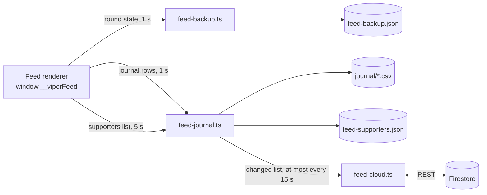

# Architecture

How the app is put together. For the vocabulary see [concepts.md](concepts.md), for what the
games do see [rules-duel.md](rules-duel.md) and [rules-feed.md](rules-feed.md), and for the
reasons behind the choices below see [decisions.md](decisions.md).

## Windows

The app opens on `launcher.html`. Picking a mode opens that mode's game window and control room
and closes the launcher; "Change mode" in a control room does the reverse.

```text
+----------------------- Electron main process -----------------------+
|  local server on 127.0.0.1:47813, serves dist/renderer               |
+---------------+--------------------------------------+---------------+
                |                                      |
      +---------v---------+   BroadcastChannel   +-----v-------------+
      |   game.html       |<---- 'viper-duel' ---+  control.html     |
      |   feed.html       |<---- 'viper-feed' ---+  feed-control.html|
      |   (on stream)     |  commands in,        |  (private)        |
      |                   |  state out (2 Hz)    |                   |
      +---------+---------+                      +-------------------+
                | WebSocket ws://localhost:21213
      +---------v---------+
      | TikFinity desktop |  likes, shares, gifts, joins
      +-------------------+
```

Only one mode runs at a time. Each has its own channel and protocol
(`src/shared/control-protocol.ts`, `src/shared/feed-protocol.ts`), so a change to one can't
break the other. Pages ask the main process for a window change by navigating to a reserved
path (`/__viper/open?mode=feed`, `/__viper/launcher`) that it intercepts, so no page needs a
preload bridge.

Some things that look odd but are on purpose:

- Local HTTP server instead of `file://`: both windows need the same origin for the
  BroadcastChannel, and the TikFinity WebSocket is easier from `http:`.
- Fixed port: localStorage depends on the port. With a random port the control room forgot its
  settings on every launch. If 47813 is taken it falls back to a free one and logs a warning.
- The game window keeps its frame: OBS and TikTok LIVE Studio capture a frameless Electron
  window as black. Crop it in the capture tool.
- Background throttling is off: the game window is captured, not looked at, and Chromium drops
  hidden windows to about 1 fps.
- All windows are sandboxed, can't navigate away, and keep their titles (capture tools pick
  windows by title: `Viper Duel`, `Viper Feed`). A second launch just focuses the open ones.
- Settings still live under the old `Viper Duel` user data folder, so the rename to Viper didn't
  reset anything.

## Duel engine

Paths below are under `src/renderer/`. `scripts/game.ts` is the simulation loop and public API,
`game/` is the page entry (control room link, seeded mode for the tests). The rest is split in
`engine/`:

| Module               | What's in it                                    |
| -------------------- | ----------------------------------------------- |
| `rules.ts`           | speeds, hazard timings, crowd tiers, prices     |
| `crowd.ts`           | audience pace and current tier                  |
| `audience-events.ts` | live events turned into board effects           |
| `hazards.ts`         | where stones and brambles can spawn             |
| `scenes.ts`          | director scenes triggered from the control room |
| `tension.ts`         | how cornered the leading snake is               |
| `layout.ts`          | frame size, grid, safe zones, format            |
| `frame.ts`           | draws one frame                                 |
| `board-items.ts`     | berries, stones, brambles                       |
| `effects.ts`         | eggshell, halos, sparks                         |
| `duel-hud.ts`        | half rings and team columns                     |
| `scoreboard.ts`      | score bar and clock                             |
| `gift-panel.ts`      | gift legend and scrolling columns               |
| `gift-feedback.ts`   | last donor per gift line                        |
| `fan-rings.ts`       | donor photos that fly onto their team's snake   |
| `crowd-energy.ts`    | likes fill one shared orb that speeds both up   |
| `like-milestones.ts` | confetti every 1,000 likes                      |
| `end-screen.ts`      | winner screen and donor ranking                 |
| `announcements.ts`   | on-stream banner                                |
| `debug-overlay.ts`   | AI debug layers (operator only)                 |
| `audio.ts`           | sound, starts on first click or key             |
| `canvas.ts`          | drawing surface                                 |
| `palette.ts`         | colours                                         |
| `i18n.ts`            | on-stream text, English and French              |

Rule I keep: a module is the only one writing its own state. Others read it or call its
functions.

## Feed the Snake

The second mode shares the canvas, the layout, the forest and the TikFinity bridge with the duel.
Its rules are its own and live in `feed/`:

| Module                     | What's in it                                            |
| -------------------------- | ------------------------------------------------------- |
| `main.ts`                  | the frame loop                                          |
| `state.ts`                 | the rules: one berry per coin, the board fills up       |
| `loop-path.ts`, `path.ts`  | the closed loop the snake follows (shortcuts are off)   |
| `grid.ts`                  | the 30×30 board                                         |
| `paint.ts`, `hud.ts`       | snake and berries, then everything around the board     |
| `flower.ts`                | the flower that blooms on a gift and drips the berries  |
| `alerts.ts`, `alert-fx.ts` | join, follow, share and like cards under the board      |
| `welcome.ts`, `vip.ts`     | the welcome on a join, the entrance of a past supporter |
| `crabs.ts`                 | Sea ambience: one crab per viewer who likes             |
| `leaderboard.ts`           | end of round: this round, then the all-time supporters  |
| `supporters.ts`            | who gave what, across lives, by TikTok id               |
| `journal.ts`               | one row per thing that happened, for reading back later |
| `sound.ts`                 | synthesised sound                                       |
| `control-link.ts`          | settings, commands, state published twice a second      |

`feed-control/` is its control room, built from the same components as the duel's. `launcher/`
is the first screen.

## Persistence and sync (Feed)

Gifts are payments, so the Feed state that represents them is persisted outside the renderer. The
renderer holds the state in memory; the main process pulls it on a timer with
`webContents.executeJavaScript` and owns every write. Pages stay sandboxed with no file or network
access of their own.



| Data              | Store                                    | Written            | Read back                               |
| ----------------- | ---------------------------------------- | ------------------ | --------------------------------------- |
| Round in progress | `feed-backup.json`                       | every 1 s, atomic  | on launch, if less than 12 h old        |
| Supporters list   | `feed-supporters.json`                   | every 5 s, atomic  | on launch                               |
| Supporters list   | Firestore, `viper/<space>` (+ `shards/`) | at most every 15 s | on launch, if newer than the local copy |
| Journal           | `journal/Viper Feed <date> <time>.csv`   | appended every 1 s | never by the app                        |

Atomic means: write to `<file>.tmp`, `fsync`, rename over the target (`writeDurably`).

**Firestore.** `feed-cloud.ts` talks to the Firestore REST API with `fetch`; there is no Firebase
SDK in the app and no user sign-in. The list is stored as one string in the document
`viper/<space>`. Past 200,000 characters it is split across `viper/<space>/shards/<i>`, written
before the head document so a reader never follows a head to parts that don't exist yet; a missing
part on read is treated as no data. The access configuration is private and not part of the
repository. Without it, or offline, the app runs on the local copy and pushes once the network is
back.

**Conflict rule.** On launch the local and online copies are compared by the `savedAt` timestamp
inside the list and the newer one replaces the other, whole. This is correct for one machine at a
time and loses data if two run concurrently. A per-supporter merge is not implemented.

## Events

1. TikFinity sends an event over the WebSocket (`tikfinity-bridge.ts`).
2. The bridge cleans it up and calls `window.receiveEvent(event)`.
3. The gift value picks the effect (speed, steal, shield, extra life), the gift name picks the
   team.
4. The control room gets the game state twice a second and sends commands back.

The fake audience (`simulated-audience.ts`) sends the same events, so rehearsals go through the
same code as a real live.

## Drawing

- Everything is drawn in a 1080×1920 frame (16×20 grid, 47 px cells), scaled to the window with
  one `setTransform`.
- 16:9 widens the frame to 3414 and only the background draws in the extra space. Gameplay
  doesn't move.
- Heavy layers (light rays, foliage, weather) are cached in offscreen canvases.

## Tests

`tests/support/boot-game.ts` loads the real game scripts in Node with a fake canvas that records
draw calls. With that:

- a golden test replays seeded scenarios and compares a hash of every draw call, so refactors
  can't change what's on screen without me noticing;
- other suites play full duels in every weather and format, and long AI vs AI sessions.

`npm run visual` does the same check on real pixels: it opens `game.html?seed=7` (seeded random,
fake clock), captures a few scenes in software rendering and diffs them with the baselines.
Baselines are from Windows since the text uses system fonts.
